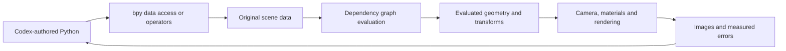

# Blender platform foundations for reusable experiments

5 September 2026. This is a bounded study of Blender's data, evaluation and rendering architecture, motivated by [Experiment 008's results](/Users/samikd/MyProjects/PyBlend/experiments/008_multiview_likeness/RESULTS.md). It is not a whole-codebase audit. The conclusions marked **application** are our engineering interpretation, not Blender's claims about character reconstruction.

The local runtime reports Blender 5.2.0 LTS, build `fbe6228777e7`. The official mirror's `v5.2.0` tag resolves to **`fbe6228777e7d9afefcd61a413844e790ae75db7`**, matching that prefix. Source links below pin this revision; they do not silently follow `main`. Official developer documentation provides architectural context, but some dependency-graph/BMesh prose describes older designs. Current implementation contracts below were cross-checked against the pinned source and its Python examples. [Release source](https://github.com/blender/blender/tree/fbe6228777e7d9afefcd61a413844e790ae75db7)

## The mental model

Think of Blender as a **structured scene database plus an evaluation machine plus renderers**. Python changes the scene's inputs; Blender computes their consequences; a renderer turns the resulting scene into pixels. This is a useful simplification of the layers described below, not a complete call graph.

**Application:** our fitting code supplies the final feedback arrow. Experiment 008 already reduced selected outline errors, but the hair, facial volume and smile remained inadequate. Understanding Blender tells us where to implement and measure better shapes; it does not supply the missing character-specific design automatically.

## 1. Scene data: objects are not their meshes

Blender's `Main` database maintains collections of IDs such as objects, meshes, materials, cameras and shape keys. An Object's `data` property refers to a separate data-block. This separation explains how object placement and underlying geometry can be managed independently. The actual `Main` structure is runtime infrastructure; it is not itself serialized as a single structure. [Main definition](https://github.com/blender/blender/blob/fbe6228777e7d9afefcd61a413844e790ae75db7/source/blender/blenkernel/BKE_main.hh), [Object data access](https://github.com/blender/blender/blob/fbe6228777e7d9afefcd61a413844e790ae75db7/source/blender/makesrna/intern/rna_object.cc#L515)

DNA describes persistent structures. During compilation, `makesdna` produces a structural description, SDNA, which is stored with `.blend` data. Loading uses the stored description and compatibility conversion; this is why a `.blend` file is more than a mesh export. RNA adds property metadata, ranges, getters/setters and update behavior; much of `bpy` is generated from it. RNA also describes runtime interfaces that do not directly correspond to DNA. [DNA](https://developer.blender.org/docs/features/core/dna/), [RNA](https://developer.blender.org/docs/features/core/rna/)

**Application:** keep an editable base mesh, bounded controls, camera settings and material variants in the scene. Save the parameter/reference provenance alongside the `.blend`. Copy the relevant mesh data when creating independent A/B/C variants; copying only an object must not accidentally leave shared editable geometry.

## 2. Python is an interface to native capabilities

Direct access such as `obj.data` goes through Blender's Python/RNA machinery. The implementation invokes RNA property updates when appropriate. `bpy.ops` instead exposes user-facing operations: they often depend on selection, active objects, editor area and mode, and return operation status rather than the created data. These are two interfaces to Blender, not two quality levels. [Python/RNA bridge](https://github.com/blender/blender/blob/fbe6228777e7d9afefcd61a413844e790ae75db7/source/blender/python/intern/bpy_rna.cc#L2238), [Operator limitations](https://github.com/blender/blender/blob/fbe6228777e7d9afefcd61a413844e790ae75db7/doc/python_api/rst/info_gotchas_operators.rst)

Inside the source tree, `blenkernel` (`BKE`) owns much of the application-level handling of Blender data, while `blenlib` (`BLI`) supplies lower-level utilities including mathematics and containers. Editors and operators sit above these foundations. This is an organizational guide, not a rule that every feature passes through an identical chain. [Code layout](https://developer.blender.org/docs/features//code_layout/), [BLI source inventory](https://github.com/blender/blender/blob/fbe6228777e7d9afefcd61a413844e790ae75db7/source/blender/blenlib/CMakeLists.txt), [BKE source inventory](https://github.com/blender/blender/blob/fbe6228777e7d9afefcd61a413844e790ae75db7/source/blender/blenkernel/CMakeLists.txt)

**Application:** use direct data access for repeatable construction and control changes; use operators where they provide needed native behavior. For an operator failure, inspect its `poll` requirements before inventing a workaround. Code-only work can use Blender's native algorithms without reproducing them in Python.

## 3. Mesh and BMesh solve different problems

The regular `Mesh` representation exposes arrays of positions, edges, face offsets and face-corner indices, with attributes on different domains. A corner is a vertex's participation in a particular face, allowing face-specific information at a shared spatial vertex. [Mesh structure and accessors](https://github.com/blender/blender/blob/fbe6228777e7d9afefcd61a413844e790ae75db7/source/blender/makesdna/DNA_mesh_types.h#L350)

BMesh stores explicit connectivity among vertices, edges, loops and faces. Its disk, radial and loop links support local topology edits; the developer guide describes primitive operations that larger editing tools compose. It is a representation for editing connectivity, not an algorithm that recognizes facial anatomy. [BMesh architecture](https://developer.blender.org/docs/features/objects/mesh/bmesh/), [Pinned structures](https://github.com/blender/blender/blob/fbe6228777e7d9afefcd61a413844e790ae75db7/source/blender/bmesh/bmesh_class.hh#L94)

**Application:** construct meaningful eyelid/lip loops and cheek transitions, then keep connectivity fixed while fitting positions or shape controls. Use BMesh when creating or changing topology. Do not repeatedly rebuild connectivity when the trial only changes coordinates. A denser mesh with the same inadequate shape basis cannot express a missing quiff or smile merely by adding vertices.

## 4. Evaluate before measuring

The dependency graph tracks relationships and computes updated scene states. Its architecture separates original inputs from evaluated results. The version-matched Python example explicitly requests `context.evaluated_depsgraph_get()` and then `obj.evaluated_get(depsgraph)` to include animation, constraints and modifiers. For a mesh object, the evaluated object's data contains the resulting mesh. [Architecture context](https://developer.blender.org/docs/features/core/depsgraph/), [Evaluated-ID example](https://github.com/blender/blender/blob/fbe6228777e7d9afefcd61a413844e790ae75db7/doc/python_api/examples/bpy.types.Depsgraph.1.py)

Calling `to_mesh()` on an original object and an evaluated object gives different results. The returned mesh is temporary and has a cleanup method, `to_mesh_clear()`; it is not a persistent scene data-block. [Ownership and conversion example](https://github.com/blender/blender/blob/fbe6228777e7d9afefcd61a413844e790ae75db7/doc/python_api/examples/bpy.types.Depsgraph.4.py)

**Application:** change original controls, trigger evaluation, then project the evaluated geometry and transforms. Record frame, view layer, modifier visibility and render/viewport settings. Measuring the input cage while showing a subdivided or deformed surface can optimize a shape the user never sees. Experiment 008's evaluated-mesh checks should remain part of future trials.

## 5. Modifiers are an ordered computation

`ModifierTypeInfo` distinguishes deformation callbacks from operations that can change geometry. Its contract says each modifier receives the mesh produced up to that point in the stack, rather than simply rereading `object->data`. The evaluator calls deformation or mesh/geometry-set operations accordingly. [Modifier interface](https://github.com/blender/blender/blob/fbe6228777e7d9afefcd61a413844e790ae75db7/source/blender/blenkernel/BKE_modifier.hh#L229), [Stack evaluation](https://github.com/blender/blender/blob/fbe6228777e7d9afefcd61a413844e790ae75db7/source/blender/blenkernel/intern/mesh_data_update.cc#L271)

**Application:** modifier order is part of the experiment specification. Deforming a coarse cage before subdivision and deforming the dense result need not produce the same surface. Once an operation changes topology, original vertex indices should not be assumed to identify the same evaluated features. Use deliberate correspondence, named feature definitions and rendered-region checks.

## 6. Rendering is a separate boundary

Blender's render-engine interface supplies the dependency graph to update/render callbacks. Cycles then synchronizes Blender scene information, including shaders, objects and motion, into its renderer. EEVEE has a separate rendering implementation oriented toward fast feedback. [Render-engine contract](https://github.com/blender/blender/blob/fbe6228777e7d9afefcd61a413844e790ae75db7/source/blender/render/RE_engine.h#L71), [Cycles synchronization](https://github.com/blender/blender/blob/fbe6228777e7d9afefcd61a413844e790ae75db7/intern/cycles/blender/sync.cpp#L297), [EEVEE design](https://developer.blender.org/docs/features/eevee/)

The bundled `world_to_camera_view` helper maps world points to normalized camera coordinates, handling orthographic/perspective projection and camera shifts. It is a projection calculation; it does not establish that a point is visible on the rendered surface. [Projection helper](https://github.com/blender/blender/blob/fbe6228777e7d9afefcd61a413844e790ae75db7/scripts/modules/bpy_extras/object_utils.py#L253)

**Application:** freeze calibrated cameras before comparing depth changes. Evaluate occlusion and masks separately from projected points. Compare clay, flat color and illustrated appearance on identical geometry so a material change cannot masquerade as a shape improvement.

## Reuse beyond the player experiment

The current work is an experiment. The following examples explain how knowledge transfers; they are not a committed product roadmap. Scene data, transforms, mesh connectivity, evaluation, materials and rendering remain relevant when the subject changes. Understanding these layers helps us select a representation, locate failures and decide what to measure. It does not determine the artistic design of a building, landscape or character for us.

| Possible later experiment | Foundations to reuse | Further investigation when needed |
|---|---|---|
| Adjustable buildings | Mesh construction, object/mesh ownership, transforms and modifier order. | Test a small building with adjustable dimensions and openings; inspect the specific generation/modifier code if its behavior blocks that test. |
| Streets, forests or repeated props | Shared scene data, transforms and evaluated output. | Geometry Nodes and instancing: test placement, variation, editability and memory use on a representative scene before choosing an approach. |
| Moving characters interacting with a setting | Dependency relationships, frame-aware evaluation and separate objects following other geometry. | Rigging, constraints, collisions and simulation caches according to the interaction being attempted. |
| A consistent illustrated world | Camera projection, visibility, materials, lighting and render-engine boundaries. | Compare representative characters and surroundings under the same appearance settings; investigate whichever rendering feature limits the result. |
| Rebuilding or revising a saved scene | Explicit Python inputs, original versus evaluated data, source snapshots and saved-file reload checks. | Test the new scene's actual external assets, modifiers and time-dependent state; the existing patch test does not certify all scenes. |

For example, an instance can have its own position, rotation and scale. That makes native instancing a candidate for placing repeated windows or trees while varying their arrangement. It does not establish a performance result for our future scene. [Instance on Points inputs](https://docs.blender.org/manual/en/latest/modeling/geometry_nodes/instances/instance_on_points.html)

Geometry Nodes, rigging and simulation internals have **not** received the source-level investigation performed for the deformation probe. They are named here as routes for future questions. The instance-node inputs were checked in bundled Blender MCP documentation because direct web retrieval of the manual failed.

## When to dig deeper

Keep a broad map of the platform, then deepen one area when a concrete experiment needs it. Begin with the public Python API and manual, inspect a working local example, run a small test, and trace the native source if the behavior or limitation remains unclear. Source study is also useful before choosing between representations when the choice would be costly to undo.

Examples of useful triggers are unexplained geometry, an update affecting the wrong objects, lost editability after saving, missing Python access, or measured time/memory problems. A specific new creative goal can also justify an investigation before a bug exists. Stop when we can explain the relevant behavior, implement it through a supported interface and reproduce the result. Future Python code should normally call supported Blender interfaces; internal function names are navigation aids, not an instruction to depend on private internals.

The next broadening candidate, if we choose a building or environment experiment, is procedural construction and instancing. A small adjustable building or repeated-prop scene would give that investigation a concrete test. There is no need to implement those scenes or a general scene framework before selecting the experiment.

## How the knowledge is retained and retrieved

The standing [problem-solving research workflow](/Users/samikd/MyProjects/PyBlend/docs/agents/issue-tracker.md#research-gates-inside-experiments) connects Blender source/docs, the paper landscape plus online research, and practical Codex–Blender projects/posts to a local hypothesis test and reusable evidence record. Apply it to new issues and design uncertainties across experiments.

Applied continuation: the [controlled smile revision](/Users/samikd/MyProjects/PyBlend/experiments/008_multiview_likeness/SMILE_REVISION.md) tests actual rendered feature masks and bounded edits. It demonstrates why changing a projected contour also requires re-evaluating its depth and surrounding skin transition. It improves a local region, not the full character's likeness.

- **Shared understanding:** this file is the entry point for platform concepts, source locations, scope and questions worth investigating next.
- **Applied evidence:** [Experiment 008's foundations note](/Users/samikd/MyProjects/PyBlend/experiments/008_multiview_likeness/BLENDER_FOUNDATIONS.md) records the hypothesis, native algorithms, numerical results, limitations and repeat command. Its linked Python probe is the executable example.
- **Run evidence:** source snapshots, hashes, runtime version, logs, result JSON and the saved `.blend` live in the linked artifact folder. These distinguish a described capability from a behavior actually observed on our runtime.
- **Future retrieval:** [AGENTS.md](/Users/samikd/MyProjects/PyBlend/AGENTS.md) directs Blender work to this guide and the relevant experiment evidence. Reuse means reading those files and rerunning applicable checks; it does not depend on a later conversation remembering this one.

For each new investigation, record the question, versioned source/API links, mechanism, tested versus inferred conclusions, smallest reproducible example, limitations and implications for the next decision. Add a new note only when it is a distinct investigation; link it here instead of duplicating the full explanation. On a Blender upgrade, rerun relevant probes before assuming version-specific findings still hold.

Documentation and scripts are saved in the repository, but saving a file does not mean it has been committed or backed up remotely. Generated evidence under `artifacts/` is currently Git-ignored and local. Repeat commands and versioned source references allow a fresh trial; preserving the exact historical binary outputs requires retaining that local evidence separately. This update did not commit, push or change the accepted product ADRs.

## Source-navigation route for the next investigation

All paths below are relative to the pinned repository above. Follow the question through these entry points rather than reading directories end to end.

| Question | Start here | What to trace next |
|---|---|---|
| What does a Python property actually change? | `makesrna/intern/rna_object.cc` under `source/blender` | Its getter/setter and update callback; corresponding DNA structure. |
| Why did a scripted operation reject context? | `doc/python_api/rst/info_gotchas_operators.rst` | Search the operator identifier; inspect `poll`, then execution. |
| Which geometry is the score measuring? | `doc/python_api/examples/bpy.types.Depsgraph.1.py` | Original/evaluated ownership; `mesh_data_update.cc`. |
| Can a native deformation replace a custom calculation? | `source/blender/blenkernel/BKE_modifier.hh` | The selected implementation in `source/blender/modifiers/intern`; its native helper and tests. |
| Where should facial connectivity be built? | `source/blender/bmesh/bmesh_class.hh` | Matching BMesh operation; compare output in regular `Mesh`. |
| Why do projected features and pixels disagree? | `scripts/modules/bpy_extras/object_utils.py` | Camera settings, world transform, visibility, then render-engine synchronization. |

The accompanying [applied study and runnable native probe](/Users/samikd/MyProjects/PyBlend/experiments/008_multiview_likeness/BLENDER_FOUNDATIONS.md) follows this route through deformation, attachment, subdivision and projection. Its synthetic checks passed, including a saved-file reload, and exposed measurable anchor drift in Laplacian Deform. The next useful result is a small, measured head-surface improvement: preserve Experiment 008's evidence loop, fix camera assumptions and expand inadequate shape controls before increasing search effort. This study does not establish a new likeness pass.

Applied hair follow-up: [source and representation research](/Users/samikd/MyProjects/PyBlend/docs/research/008-hair-representation.md) and [controlled result/replay](/Users/samikd/MyProjects/PyBlend/experiments/008_multiview_likeness/HAIR_REVISION.md) cover profile sweeps, region-preserving replacement and actual hair-mask measurements. The local result improves the hairline but exposes cross-view regressions; it does not establish a likeness pass or reuse across characters.

Full static body reuse: [native union and garment attachment research](/Users/samikd/MyProjects/PyBlend/docs/research/008-full-body-construction.md) and [body_005 result/replay](/Users/samikd/MyProjects/PyBlend/experiments/008_multiview_likeness/FULL_BODY.md) demonstrate separate checks for connectivity, open source gaps, clothing coverage and saved-file preservation. Dense static remesh topology remains a separate problem from animation deformation.

Native armature continuation (6 September 2026): [pinned source/paper investigation](/Users/samikd/MyProjects/PyBlend/docs/research/008-rig-deformation.md) and [rig_003 results and repeat instructions](/Users/samikd/MyProjects/PyBlend/experiments/008_multiview_likeness/RIG_PROOF.md). The local proof reproduces group-based dual-quaternion deformation, transform-preserving rigid attachments and a controlled skinning comparison. Its failed trials identify discontinuous/incorrect weight ownership as the cause of thumb and elbow artifacts.

Face-surface reuse (6 September 2026): [source/method investigation](/Users/samikd/MyProjects/PyBlend/docs/research/008-face-surface-continuity.md) and [face_010 result/replay](/Users/samikd/MyProjects/PyBlend/experiments/008_multiview_likeness/FACE_SURFACE.md) test native smoothing on the actual head. They document volume-correction scope, constrained-boundary creases, a measured contour-drift budget, shape-key preservation and material-only comparisons. Smoother geometry does not establish better likeness.

Running and hand-pose reuse (6 September 2026): [source/method investigation](/Users/samikd/MyProjects/PyBlend/docs/research/008-running-hands.md) and [running continuation and replay](/Users/samikd/MyProjects/PyBlend/experiments/008_multiview_likeness/RUNNING.md) cover rest-local curl keys before Armature, explicit palm roll, analytic contacts and actual root-travel checks. Stronger poses expose garment clearance failures; outside-only Shrinkwrap needs bounded offsets and protection for open collars and volumetric trims. The retained nearest-normal disagreement demonstrates why a negative local projection alone cannot certify penetration. These are character-specific motion and diagnostic findings, not a general rig, cloth solver or throughput result.

Second-character transfer (6 September 2026): [bounded source/paper/project findings](/Users/samikd/MyProjects/PyBlend/docs/research/009-character-reuse.md) and [Experiment 009 results/replay](/Users/samikd/MyProjects/PyBlend/experiments/009_second_player_reuse/RESULTS.md) extend the approved running workflow to a second reference. Reusable findings include rest-coordinate hand transfer, consistent mesh/key/skeleton maps, baking anisotropic scaling into rigid boot geometry, rechecking saved vertices, stable object names, and reacquiring datablocks after file reload. Generated view sheets remain inferred references, and manual landmark agreement does not establish likeness.

Photographic likeness correction (6 September 2026): the creator rejected Experiment 009's face. [Experiment 010's plan and replay](../../experiments/010_identity_reconstruction/PLAN.md) retain an executed counterexample: substantial nose-depth changes preserve the old front-landmark score. Native camera projection reproduced this blind spot; the rejected head and animation binaries remain unchanged. [Face-specific reconstruction candidates](010-head-reconstruction-candidates.md) and [pipeline/platform findings](010-likeness-pipeline.md) distinguish measured local behavior from paper results and project claims. Reuse the motion workflow after an identity pass; do not reuse the fixed face surface or eight-point score as a certified reconstruction method. The selected direction is real proportions first, shared-identity fitting to real photos, and a static head comparison before further animation. At that research stage no reconstruction model had run locally.

Local identity initialization (7 September 2026): [Experiment 010 results and replay](../../experiments/010_identity_reconstruction/RESULTS.md) now prove CPU MICA inference and an editable neutral-head import through Blender MCP. The official checkpoint supplies its own decoder buffers. Preserve metre units, handedness, face order and evaluated identity coordinates when importing; technical save/reload passes do not establish likeness. Retained failures cover restricted checkpoint loading and overexposed review lighting. This is one photographic head, with no accepted likeness, multi-photo fit or batch reliability result.

Grease Pencil cutout reuse (8 September 2026): [Experiment 011's investigation](../../experiments/011_dawn_training/RESEARCH.md) and [repeat commands](../../experiments/011_dawn_training/README.md) retain native SVG-group-to-layer import, Bezier position/handle coordinate conversion, bone-parented drawing layers, explicit `fill_id` / `hide_stroke` requirements for new filled curves in build `fbe6228777e7`, and a source-resampling-before-chroma-mask correction. The local result is a 30-second reference-based cutout first cut with separate artwork, rig, pose and film scenes. It does not certify arbitrary deformation, high-resolution hand-inked likeness, or the broader platform's character/motion matrix.
