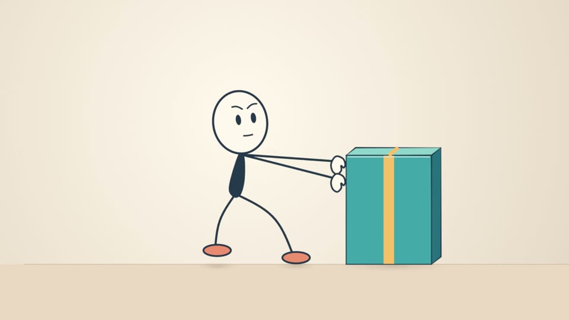
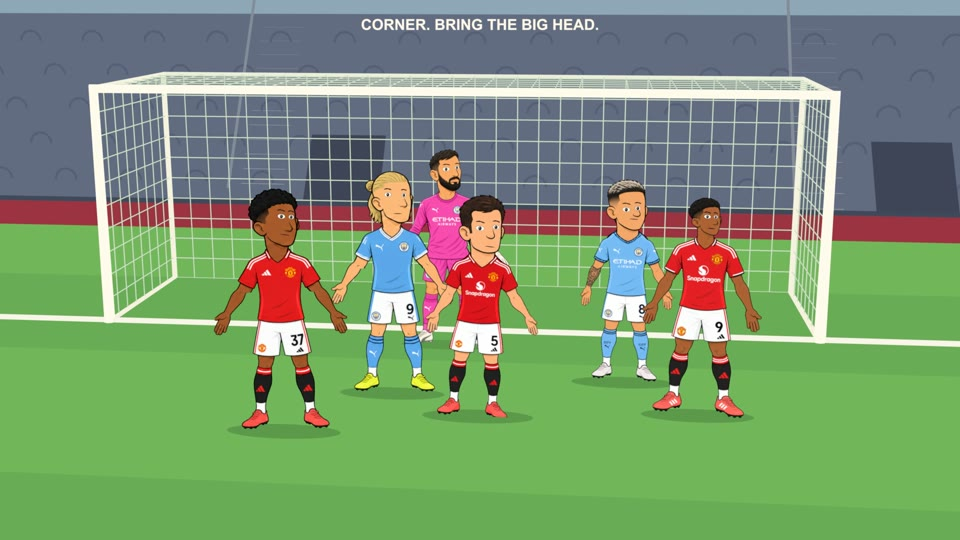
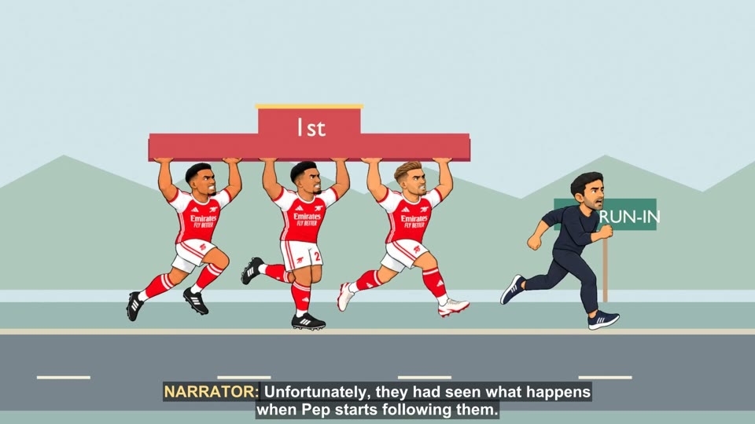

# Pencil

**A code-driven animation lab and production archive.** Pencil explores whether Codex, Python, and Blender can make short films that are expressive on screen, editable afterward, and clear enough to revise shot by shot. It began with a simple character pushing a box and grew into factual football stories, a reference-matched everyday comedy, and the Samtoons football-comedy production.

| Early motion test | Football story | Samtoons comedy |
| --- | --- | --- |
|  |  |  |
| [Heavy Box](experiments/001_heavy_box/README.md) | [Manchester derby](productions/Samtoons/videos/001-manchester-derby-2026-09-13/brief.md) | [Arsenal comedy](productions/Samtoons/videos/002-how-arsenal-won-the-league/brief.md) |

*Frames from rendered films in this repository. They show different treatments; none is a mandatory Pencil style.*

## What the experiment tests

The central question is: **Can code help author animation without sacrificing acting, visual quality, sound, or the ability to change a scene later?** The work tests that question on actual shots and finished films:

- **Editable construction:** Python builds or modifies native Blender scenes. Character bodies can be simple, but poses, contact, movement, facial acting, camera, and environment must read in the finished cut.
- **Revision without erasure:** Each film keeps its brief, scripts, selected assets, editable `.blend` files, review notes, and versioned deliveries. A change should preserve accepted work outside its scope.
- **Picture and sound together:** Voice, effects, music, silence, timing, and visual action are planned and reviewed as one audiovisual sequence.
- **Evidence over templates:** A working rig, still image, technical check, or successful earlier film proves only what was actually tested. New films choose their own subject, visual treatment, format, and duration.

The reusable result is a **production method**, not one character design. Samtoons is the current football-comedy identity; Pencil can support other subjects. Real football incidents and factual educational stories require source checks. Invented dialogue and physical exaggeration belong to a film's chosen treatment and should remain distinguishable from the underlying facts.

## Watch the work

| Work | What it explored | Film and notes |
| --- | --- | --- |
| **Heavy Box** | The first 10-second action test: readable effort, continuous contact, editable motion, and a targeted revision. | [Watch](experiments/001_heavy_box/artifacts/finish-v002/preview-with-sound.mp4) · [Blender source](experiments/001_heavy_box/artifacts/finish-v002/character-and-effects.blend) · [Experiment](experiments/001_heavy_box/README.md) |
| **The Goalkeeper Who Scored the Winner** | A complete vertical football Short about Alisson's 2021 winner. | [Watch](experiments/003_alisson_winner/artifacts/film-v001/the-goalkeeper-who-scored-the-winner.mp4) · [Notes](experiments/003_alisson_winner/README.md) |
| **How Was This Ball Still In?** | A visual explanation of Japan's 2022 goal against Spain and the whole-ball rule. | [Watch](experiments/004_japan_line/artifacts/film-v001/how-was-this-ball-still-in.mp4) · [Notes](experiments/004_japan_line/README.md) |
| **Three Goals. One Heartbreak.** | Recognizable player faces on simple expressive bodies, with original sound and editable native motion. | [Watch](experiments/005_three_goals/artifacts/film-v001/three-goals-one-heartbreak.mp4) · [Notes](experiments/005_three_goals/README.md) |
| **Just Five Minutes** | A different niche and a reference-matched limited-animation treatment. | [Watch](experiments/006_just_five_minutes/artifacts/film-v001/just-five-minutes.mp4) · [Notes](experiments/006_just_five_minutes/README.md) |
| **Barcelona wasn't ready. Trent was.** | Football staging, supporting cast, close-ups, and a revised 38-second film. | [Watch](experiments/007_trent_corner/artifacts/film-v004/barcelona-wasnt-ready-trent-was.mp4) · [Notes](experiments/007_trent_corner/README.md) |
| **Samtoons: Manchester derby** | A longer animated parody with recognizable players, scene changes, voices, and a native Blender delivery. | [Watch](productions/Samtoons/videos/001-manchester-derby-2026-09-13/artifacts/delivery-v003/samtoons-final-1080p.mp4) · [Delivery](productions/Samtoons/videos/001-manchester-derby-2026-09-13/artifacts/delivery-v003/README.md) |
| **Samtoons: Arsenal comedy** | A completed, approved cut followed by a documented audit of acting and reuse limits. | [Watch](productions/Samtoons/videos/002-how-arsenal-won-the-league/artifacts/delivery-v029/samtoons-final-1080p.mp4) · [Delivery](productions/Samtoons/videos/002-how-arsenal-won-the-league/artifacts/delivery-v029/README.md) · [Audit](productions/Samtoons/videos/002-how-arsenal-won-the-league/research/benchmark-audit-v001/report.md) |

The [Barcelona emergency meeting](productions/Samtoons/videos/003-barca-emergency-meeting/Samtoons_Barcelona_Emergency_Meeting_Script_Brief.md) is recorded at staging, with selected native scenes and reviews; it is not a finished film. Earlier rough work and construction tests remain under [`experiments/`](experiments/).

## Find your way around

| Path | Purpose |
| --- | --- |
| [`productions/`](productions/README.md) | Normal film work. A production has its own creative profile and reusable assets; each video owns its brief, script, plan, journal, sources, and deliveries. |
| [`experiments/`](experiments/) | Historical films and focused tests. They are evidence and possible technique references, not starting templates for every new film. |
| [`pipeline/`](pipeline/README.md) | Shared workflow, audio and checkpoint tools, style guidance, and implementation notes. |
| [`research/`](research/) | Source checks, visual references, sound research, and earlier strategy exploration. |
| [`PyBlend_Stickman_Starter/`](PyBlend_Stickman_Starter/) | Historical construction reference. Its unfinished plans and creative choices do not govern new work. |
| [`ARCHIVE.md`](ARCHIVE.md) | What this GitHub copy includes, what stays local, and known gaps. |

### Guides for a new or resumed film

1. Read [`AGENTS.md`](AGENTS.md), the [production terms](CONTEXT.md), and the [authoritative animation workflow](pipeline/SKILL.md).
2. Read the relevant production profile—[Samtoons](productions/Samtoons/README.md) for the football comedy—then the video's brief, selected script, `production.json`, and latest `events.jsonl`. Follow recorded selections; the newest filename is not necessarily current.
3. Open only the guides needed for the work: [character construction](pipeline/styles/construction.md), [motion planning](pipeline/motion-planning.md), [sound planning](pipeline/sound-planning-method.md), or the [19-option visual reference menu](pipeline/styles/menu.png) ([interactive gallery to open locally](pipeline/styles/gallery.html)). The menu's attributed external artwork is a quality reference, not a finished Pencil scene.
4. Develop the actual story and shots, then review staging, sound, animatic, and delivery through the shared workflow. Keep earlier accepted versions and record the decisions in the existing journal.

## Using this archive

Large selected `.blend`, video, and audio files use Git LFS:

```sh
git lfs install
git clone https://github.com/samikd35/pencil.git
cd pencil
git lfs pull
```

This is a **curated archive** of source code, production records, reusable assets, selected editable Blender files, and selected films. Generated previews, caches, and some superseded work remain outside GitHub. The Qwen voice runtime was moved to `~/Models/qwen-voice` on the original computer; model weights are not in this repository. Some Arsenal source files were already missing from the local project, so its complete editable reconstruction is unverified. Read [the archive inventory and limits](ARCHIVE.md) before relying on this copy as a backup.
