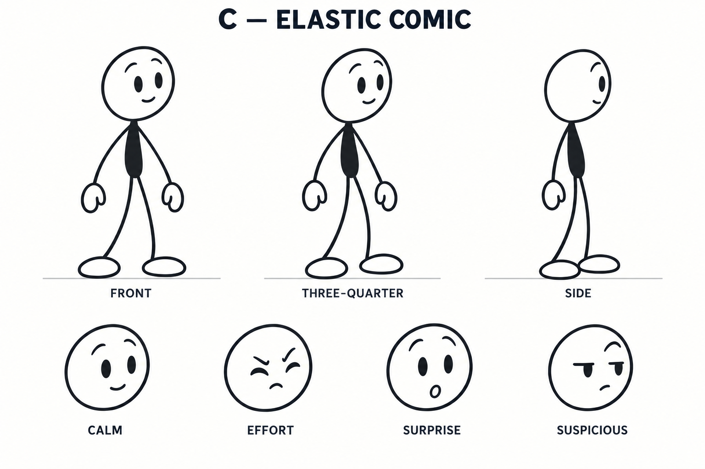
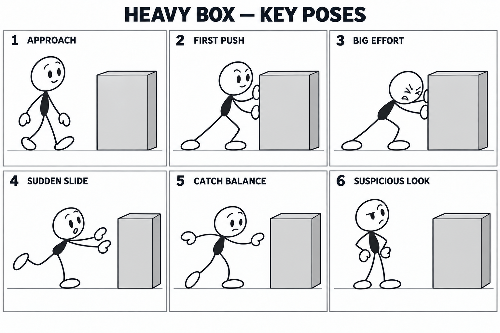

# Selected direction: C — Elastic Comic

The user explicitly chose C from the [original options](options-v001.png). Earlier research recommending B is historical and superseded by this choice.

## Character reference

[Exact generation prompt](character-c-v001.prompt.txt). Generated with the built-in image tool, using the original option board as visual reference and specifying only C. The underlying image-model identity was not exposed.

Retained traits: outlined oval white head, simple eyes/brows/mouth, small charcoal bean torso, long slender curved limbs, mitten hands, and oval shoes. The three views are proposed drawing interpretations, not a validated geometric turnaround. Front and three-quarter remain visually similar. The profile hides the far arm through overlap. These references guide the clean editable character; they are not the rig itself.

## Action proposal

[Exact generation prompt](key-poses-c-v001.prompt.txt). Generated with the built-in image tool using the character sheet as reference.

The six acting beats are approach, first push, big effort, sudden slide, catch balance, and suspicious look. The original approximately ten-second timing is a starting point to refine in motion, not a rigid requirement for future work.

## Visual inspection and limits

- C's small filled torso, thin limbs, mittens, shoes, and facial vocabulary remain recognizable across the drawings.
- The effort and surprised recovery poses communicate the intended gag in stills.
- Box position varies slightly between panels beyond the intended slide. Use one box and one fixed camera in Blender; do not translate each panel into literal screen coordinates.
- Hands are simplified and overlapping in the pushing views. Author actual contact points and inspect both hands through the moving interval.
- Foot plants, exact limb lengths, balance, and temporal continuity have not been validated in animation. Reconstruct stable proportions rather than tracing each pose independently.
- The user selected the direction, not every newly generated view or pose. No additional user approval or production-quality pass is claimed.

## Next production step

Build a clean editable C character and a rough continuous motion pass. Use these drawings for appearance and acting intent. Record the construction method and any needed drawing corrections in the production journal, then judge the result through motion previews and the targeted revision test.
