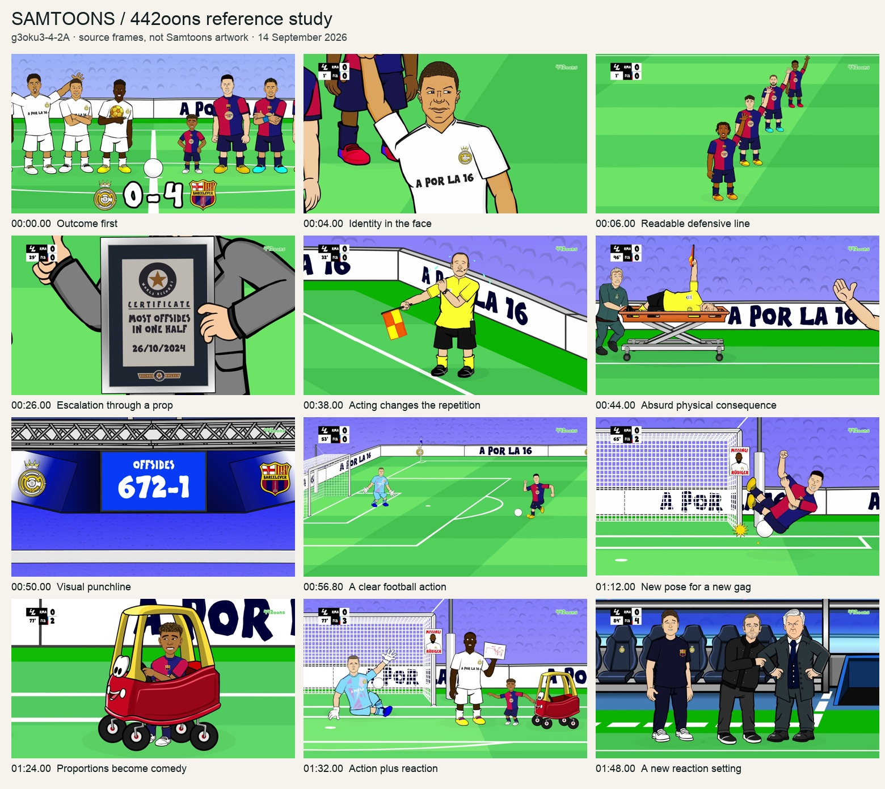

# 442oons Clásico reference analysis

Prepared **14 September 2026** for Samtoons. Source: [0–4 Real Madrid vs FC Barcelona — 442oons](https://www.youtube.com/watch?v=g3oku3-4-2A), published 27 October 2024. [Metadata](reference-v001/source-metadata.json) · [creator/event research](source-context.md) · [study copy](reference-v001/source.mp4).

## What the reference establishes

This is an economical football caricature comedy with deliberately simplified bodies and detailed identity cues. It compresses a real match into recurring visual jokes, goal actions and reactions. The result is disclosed at the beginning; the attraction is how the humiliation unfolds, rather than uncertainty about the winner. This is an interpretation of the inspected images, not an audience-retention finding.

## Evidence and limits

- **Directly inspected:** 59 full-film samples at two-second intervals, twelve selected full-resolution frames, and three action sequences sampled every 0.1 second. The sequence sheets show changes between poses; they are not a normal-speed playback review. Some opening/mid-film frames were also inspected in the YouTube player.
- **Verified metadata:** a 1920×1080, 30 fps video stream; 3,489 frames / 116.3 seconds of picture. Container duration is about 116.327 seconds. These numbers describe the retrieved stream, not a 30-drawings-per-second animation method.
- **Audio:** downloaded and measured, but the assistant could not directly hear it through the available tools. YouTube captions were unavailable in the player and through the transcript API. A local automated transcription produced unreliable repetitions and was rejected. No dialogue transcript, voice-performance rating, music identification, listening-quality rating or lip-sync verdict is claimed.
- **Not established:** exact software/rig used in 2024, clean motion on every frame, production hours for this film, retention, viewer comprehension, or repeatability in Pencil. Those require other evidence. Source research includes historical creator testimony, explicitly dated and scoped.

Retained overview sheets: [00:00–00:34](reference-v001/overview-01.jpg), [00:36–01:10](reference-v001/overview-02.jpg), [01:12–01:46](reference-v001/overview-03.jpg), [01:48–01:56](reference-v001/overview-04.jpg). [Original compressed audio](reference-v001/source-audio.webm) is available for a later listening review.

## Story layout

Times below are approximate visual beat boundaries, not a frame-accurate edit decision list. Each link opens the original around the start of the beat. This table describes the cartoon, not a factual match report.

| Source time | Visible beat | Story function |
|---|---|---|
| [00:00–00:03](https://www.youtube.com/watch?v=g3oku3-4-2A&t=0s) | Rival lineups and the 0–4 result. | Promise the subject and outcome immediately. |
| [00:03–00:25](https://www.youtube.com/watch?v=g3oku3-4-2A&t=3s) | Mbappé repeatedly breaks beyond the defensive line; flag responses recur. | Teach the running joke, then vary its staging. |
| [00:25–00:29](https://www.youtube.com/watch?v=g3oku3-4-2A&t=25s) | A mock offside certificate. | Turn repetition into an absurd achievement. |
| [00:29–00:43](https://www.youtube.com/watch?v=g3oku3-4-2A&t=29s) | Apparent goal, reversal, tired flag arm and another mock award. | Offer success briefly, then increase the embarrassment. |
| [00:43–00:51](https://www.youtube.com/watch?v=g3oku3-4-2A&t=43s) | Stretcher gag and exaggerated half-time offside total. | Give the first routine a larger visual payoff. |
| [00:51–01:09](https://www.youtube.com/watch?v=g3oku3-4-2A&t=51s) | Lewandowski's two goals; the official returns with an arm sling. | Reverse which team converts chances; retain the callback. |
| [01:09–01:21](https://www.youtube.com/watch?v=g3oku3-4-2A&t=69s) | Missed chances become physical slapstick. | Interrupt success with a different kind of joke. |
| [01:21–01:39](https://www.youtube.com/watch?v=g3oku3-4-2A&t=81s) | Child-sized Yamal, toy car, drawing, goal and dance. | Make character design and props carry a fresh comic routine. |
| [01:39–01:50](https://www.youtube.com/watch?v=g3oku3-4-2A&t=99s) | Raphinha's finish and touchline reactions. | Complete the result and show its emotional consequences. |
| [01:50–01:56](https://www.youtube.com/watch?v=g3oku3-4-2A&t=110s) | Final referee/player retaliation gag, then branded end card. | Return to the opening conflict and close. |

The opening offside routine occupies roughly 48 seconds after the title. It is already close to the length of an entire Samtoons Short. Compressing all of the source's routines into 45 seconds would remove the pauses and reactions that make them legible. Instead, select one main incident or comic thread and give it a complete ending.

## Animation style and quality

| Element | Visible evidence | Transfer to Samtoons |
|---|---|---|
| Likeness | The [00:04 face](reference-v001/frames/frame-004.00.jpg) uses a specific jaw, hairline, eyes and mouth; [01:48 coaches](reference-v001/frames/frame-108.00.jpg) remain distinguishable in dark clothes. | Design a few strong identity cues for each person. Kit color alone is insufficient. |
| Proportions | Adult players vary in build; [01:24 Yamal](reference-v001/frames/frame-084.00.jpg) is exaggerated to child scale. | Proportions can express a joke. Choose them intentionally for the individual character. |
| Drawing finish | Dark outlines, flat fills, restrained facial shading, visible sleeves, fingers, collars, shorts, socks and boots. | A face and body must share one drawing language. Simplify construction while retaining authored hands and expressions. |
| Environment | A graphic green pitch, repeated crowd marks, perimeter boards and a few goal/touchline views. | Spend detail on faces, contact and joke props. Backgrounds establish location and support readability. |
| Staging | [00:06](reference-v001/frames/frame-006.00.jpg) arranges defenders diagonally so the line and escaping attacker can be read together. | Frame the cause and consequence. Arrange supporting figures; do not stack them randomly. |
| Props | Certificate, trophy, sling, stretcher, toy car and drawing each change a joke. | Add a prop when it causes or clarifies a beat, rather than as decoration. |
| Camera/edit | Wide actions alternate with face/prop inserts and reaction shots; graphic wipes separate some beats. | Use shot changes to reveal information, and avoid camera movement without a story purpose. |
| Acting | The flag arm changes from routine signaling to strain and injury; bodies later fall, dance and gesture. | Repetition must evolve. New emotions need new posing, timing or expression. |

The reference's strongest visible quality is **readable, character-specific performance with disciplined reuse**. The inspected images show selective motion and repeated staging, not uniformly elaborate full-body animation. Its detailed kit text and background signs can become small at phone scale; their existence is not a reason to fill a Short with equally small lettering.

### Motion evidence

1. [Offside sequence, 00:04.80–00:06.70](reference-v001/offside-motion.jpg): the attacker runs past a mostly held defensive line, defenders signal, the ball travels, then the edit reveals the official. Movement directs attention; the whole cast does not need constant motion.
2. [Goal approach and kick, 00:56.10–00:58.00](reference-v001/kick-motion.jpg): the composition opens to show striker, ball, keeper and goal; a short wind-up leads to ball departure, a keeper dive and a settled result. At this sampling interval it supports the action structure, not sub-frame contact accuracy.
3. [Miss and fall, 01:10.90–01:12.80](reference-v001/fall-motion.jpg): the action moves through approach, extended leg, tilted airborne body and seated recovery. This needs pose changes beyond translating a standing character across the image.

For Samtoons, a still with a good face is only the design benchmark. The motion benchmark must include the actual film's turn, reach, kick, impact, reaction or other demanding action. A successful inherited rig test does not establish any of these performances.

## Facts and parody

The real match was 0–0 at half-time and ended 0–4, with Lewandowski scoring twice, followed by Yamal and Raphinha. Use the [dated official records and report](source-context.md#historical-event-behind-the-parody) for chronology and outcome.

Treat the cartoon's awards, enormous offside total, injured flag arm, toy car, literal drawing exchange, dance platform and retaliation as authored visual jokes, not documentary evidence. The cartoon's clock labels are also not the timing authority: sampled frames label early goals at 53′/55′ while the official match record lists 54′/56′. Verify football details independently even when the source joke appears to follow the match closely.

## Sound evidence boundary

[Media checks](reference-v001/media-checks.json) describe the local study copy and the extraction limits. The AAC copy measured approximately **−11.39 LUFS integrated, +1.90 dBTP true peak and 5.50 LU loudness range**. These are measurements of a transcoded study copy, not the original master or the loudness a YouTube listener necessarily receives. The positive true-peak value is a reason not to adopt its level mechanically. No audible distortion is inferred from that number alone.

The proposed Samtoons sound requirements are therefore original production criteria: plan voices or vocal reactions, action sounds, ambience and music alongside the picture; audition their identity; align important contacts; protect the punchline; and listen to the final encode. Source-specific sound and lip-sync comparisons remain open.

## Retrieval notes

The first web fetch returned 429. The installed June 2026 downloader retrieved metadata and part of the video but subsequent media requests returned 403. An isolated newer downloader recovered the full 1080p picture and an Opus audio stream; FFmpeg made the AAC study copy. Its conversion emitted one Opus packet-header warning; the completed MP4 subsequently passed full decode without errors. This copy is suitable for the recorded visual study, but its audio must not be presented as an untouched master. Original compressed audio is retained alongside it for future listening verification. Unreliable automatic transcript text is excluded from this reference pack.
